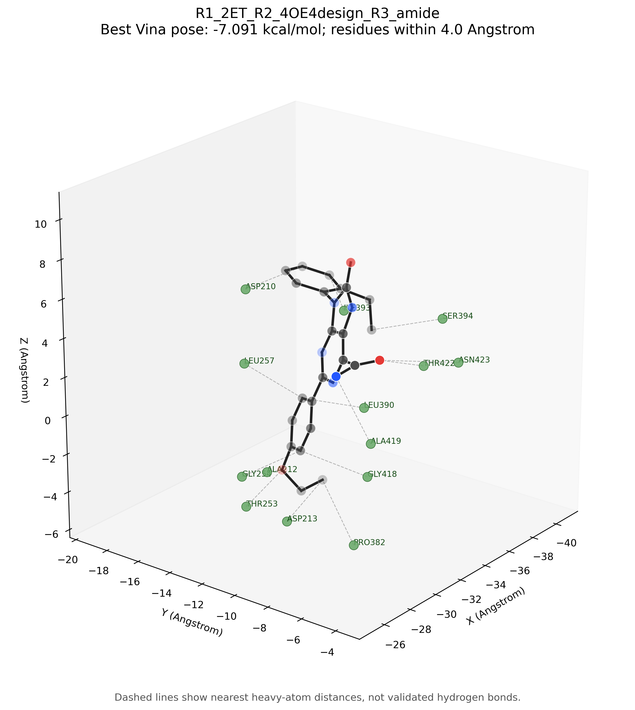
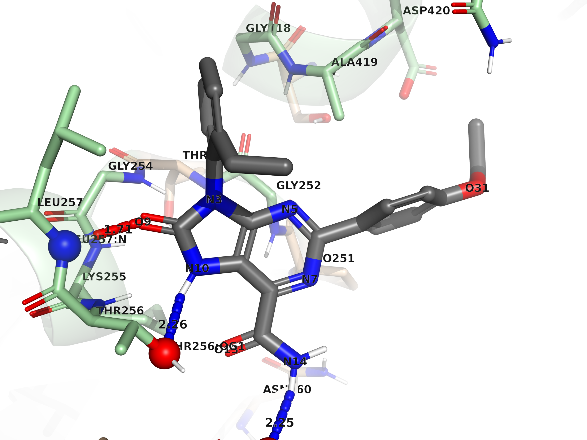
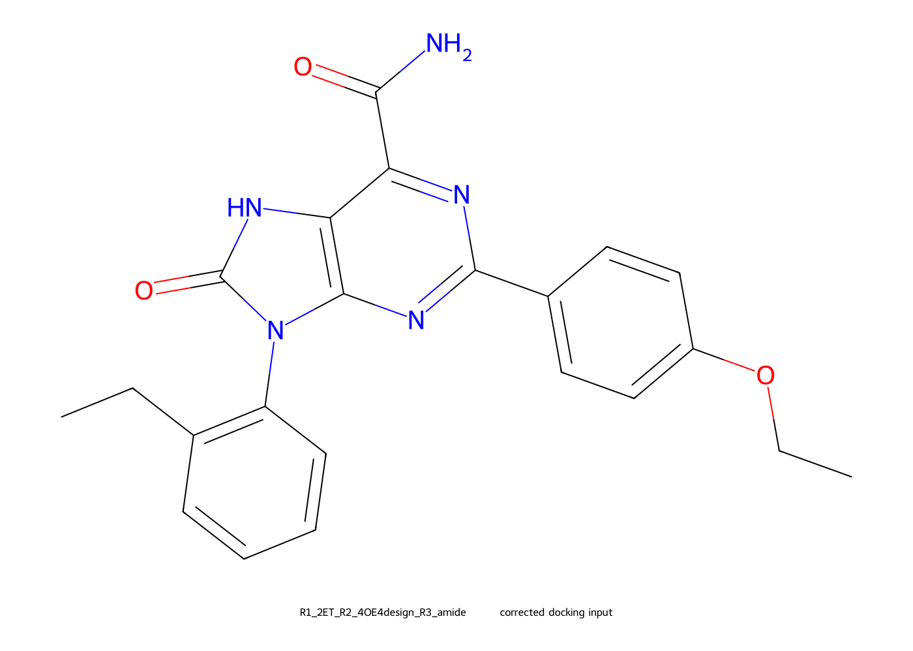

# Katanin Molecular Docking: R1_2ET_R2_4OE4design_R3_amide

This repository contains a single-ligand AutoDock Vina docking example for
`R1_2ET_R2_4OE4design_R3_amide` against human katanin catalytic subunit A1
(KATNA1), using a receptor prepared from PDB entry **5ZQM**.

## Result

| Ligand | Best Vina score | Poses |
|---|---:|---:|
| R1_2ET_R2_4OE4design_R3_amide | -7.091 kcal/mol | 10 |

The ten predicted modes ranged from -7.091 to -6.157 kcal/mol. Docking scores
are model-dependent ranking values and should not be interpreted as measured
binding free energies or proof of biological activity.

An independent standardized rerun regenerated the ligand PDBQT and produced a
top-ranked score of **-6.979 kcal/mol**. The regenerated ligand PDBQT was not
byte-identical to the archived input, explaining the small score difference.
Under the rerun conditions, Model 6 scored **-6.569 kcal/mol**.

### Best-pose pocket view



Fourteen receptor residues have at least one heavy atom within 4.0 Angstrom of
the best-ranked pose: ALA212, ASP210, ASP213, THR253, GLY254, LEU257, PRO382,
LEU390, ILE393, SER394, GLY418, ALA419, THR422, and ASN423.

The two polar heavy-atom contacts within 3.5 Angstrom are O...O pairs involving
ALA212 and THR253. They should **not** automatically be called hydrogen bonds;
both atoms may be acceptors. No unambiguous strong hydrogen bond was assigned
from the PDBQT coordinates alone. The predicted pose therefore appears to rely
primarily on pocket shape, hydrophobic contacts, and van der Waals interactions,
but this interpretation remains computational and requires experimental
validation.

### Model 6: explicit-H hydrogen-bond candidate pose



Unlike top-ranked Model 1, Model 6 contains three donor-H...acceptor geometries
that pass the applied criteria: H...A <= 2.5 Angstrom, D...A <= 3.5 Angstrom,
and D-H...A angle >= 120 degrees.

| Interaction | H...A | D...A | Angle |
|---|---:|---:|---:|
| LEU257 N-H...ligand O9 | 1.71 A | 2.73 A | 167.4 degrees |
| Ligand N10-H11...THR256 OG1 | 2.26 A | 3.12 A | 142.0 degrees |
| Ligand N14-H15...ASP308 OD1 | 2.25 A | 3.13 A | 144.6 degrees |

These are geometrically plausible computational hydrogen-bond candidates, not
experimentally confirmed interactions. Model 6 has more interpretable polar
contacts but a less favorable Vina score than Model 1, so both poses should be
treated as hypotheses rather than a definitive binding mode.

## Ligand structure

The repository uses one ligand structure throughout the workflow:

`data/ligand/R1_2ET_R2_4OE4design_R3_amide.mol`



- Molecular formula: `C22H21N5O3`
- Heavy atoms: 30
- SMILES: `CCOc1ccc(-c2nc(C(N)=O)c3[nH]c(=O)n(-c4ccccc4CC)c3n2)cc1`

This is the structure used to generate the ligand PDBQT and the reported
docking result. Its chemical identity, protonation state, tautomer,
stereochemistry, and bond orders should still be independently verified before
treating the result as a structure-activity conclusion.

## Repository structure

```text
.
├── README.md
├── requirements.txt
├── config/
│   └── vina_box.txt
├── data/
│   ├── ligand/
│   │   └── R1_2ET_R2_4OE4design_R3_amide.mol
│   └── receptor/
│       └── katanin.pdbqt
├── results/
│   ├── docking_summary.csv
│   ├── contact_summary.csv
│   ├── explicit_hbond_summary_model6.csv
│   ├── interaction_notes.md
│   ├── R1_2ET_R2_4OE4design_R3_amide.sdf
│   ├── R1_2ET_R2_4OE4design_R3_amide.pdbqt
│   ├── R1_2ET_R2_4OE4design_R3_amide_2D.png
│   ├── R1_2ET_R2_4OE4design_R3_amide_binding_pose_3D.png
│   ├── mode6_explicit_H_bonds_5A.png
│   ├── R1_2ET_R2_4OE4design_R3_amide_docked.pdbqt
│   └── R1_2ET_R2_4OE4design_R3_amide_vina.log
├── scripts/
    ├── analyze_best_pose.py
    └── run_single_ligand_docking.py
└── visualization/
    ├── katanin_receptor.pdb
    ├── R1_2ET_R2_4OE4design_R3_amide_mode1.pdb
    ├── R1_2ET_R2_4OE4design_R3_amide_mode6.pdb
    ├── mode6_explicit_hbonds_5A.pml
    └── view_best_pose.pml
```

## Docking configuration

- AutoDock Vina: 1.2.7
- Scoring function: Vina
- Exhaustiveness: 32
- Random seed: 20261115
- Number of modes: 10
- Grid center: `(-27.267, -10.371, 1.145)`
- Grid size: `(22.273, 20.000, 20.000)` Angstrom

## Requirements

- Python 3
- RDKit
- Meeko (`mk_prepare_ligand.py`)
- AutoDock Vina command-line executable (`vina`)

The script generates a 3D conformer with ETKDGv3, performs MMFF geometry
optimization, prepares the ligand with Meeko, and runs AutoDock Vina.

## Interactive PyMOL view

Launch PyMOL from the repository root:

```bash
pymol visualization/view_best_pose.pml
```

The script displays the receptor cartoon, the best-ranked ligand pose, pocket
residues within 4.0 Angstrom, and distance-based polar contacts. The dashed
polar-contact objects are geometric candidates only, not validated hydrogen
bonds.

## Reproduce the docking

From the repository root:

```bash
python scripts/run_single_ligand_docking.py
```

The rerun outputs are written to `reproduced_results/`, which is ignored by
Git. Results can vary if software versions, receptor preparation, ligand
protonation, or other parameters differ.

## Interpretation limitations

- A docking score is not an experimental dissociation constant or IC50.
- Differences of approximately 1-2 kcal/mol may fall within the uncertainty of
  the scoring and preparation workflow.
- Solubility, permeability, aggregation, protonation, and assay conditions are
  not established by this calculation.
- The predicted poses require visual inspection and experimental validation.

## Citation

If this workflow is used in scientific work, cite AutoDock Vina and the
original structural entry (PDB 5ZQM). The Vina log included here lists the
recommended AutoDock Vina publications and DOIs.

